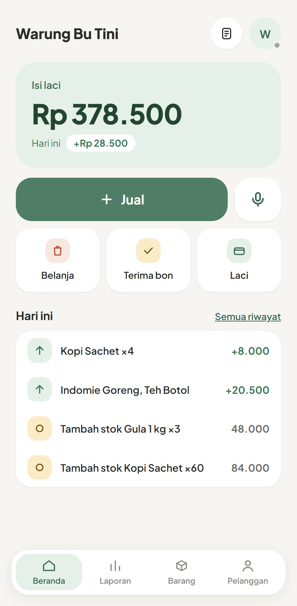
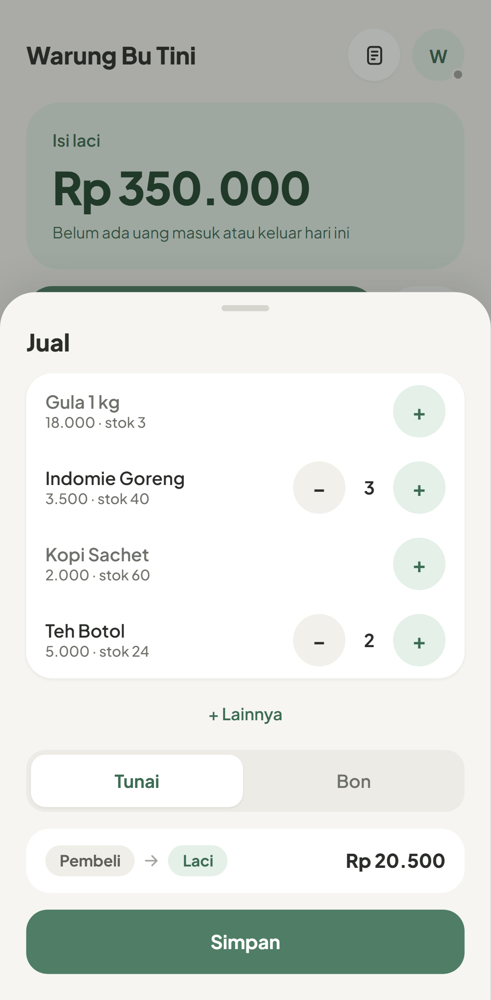
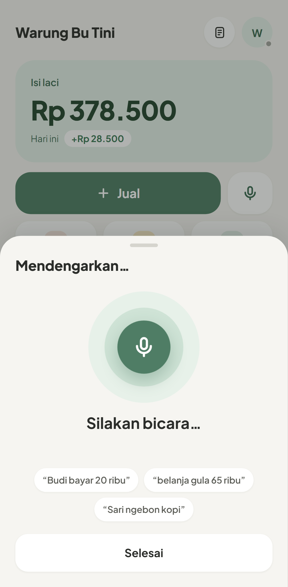
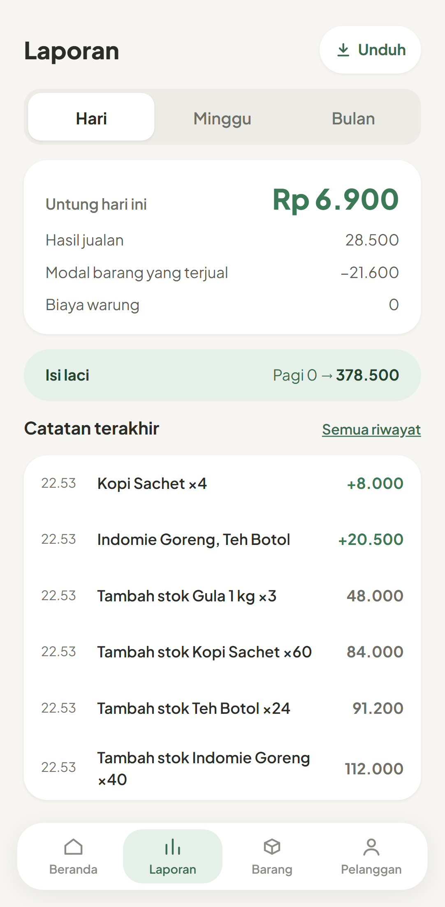

# Buku Warung

Aplikasi pembukuan sederhana untuk warung dan pedagang kaki lima. Catat jualan, belanja, dan bon dari HP, lalu lihat berapa isi laci dan untung hari ini. Jalan tanpa sinyal, tanpa perlu paham akuntansi.

**Demo:** [zeevolker.github.io/buku-warung](https://zeevolker.github.io/buku-warung/)

<p>
  
  
  
  
</p>

*Tangkapan layar memakai data contoh.*

## Masalah yang ingin diselesaikan

Banyak pemilik warung dan pedagang kaki lima tidak mencatat keuangan, atau hanya mencatat di buku tulis. Akibatnya mereka sulit tahu untung sebenarnya, lupa siapa yang masih berutang, dan baru sadar barang habis saat pembeli sudah menanyakannya.

[Tambahkan 2-3 kalimat dari hasil wawancaramu: siapa yang kamu tanya, apa kata mereka tentang cara mencatat sekarang.]

## Cara pakai

| Kejadian di warung | Yang ditekan |
|---|---|
| Barang laku, dibayar langsung | **Jual** → pilih barang → *Tunai* |
| Barang laku, dibayar nanti | **Jual** → pilih barang → *Bon* → nama pelanggan |
| Jualan tanpa stok (gorengan, pulsa) | **Jual** → *+ Lainnya* → isi nominal |
| Belanja barang ke agen | **Belanja** → stok ikut bertambah |
| Bayar listrik, plastik, gas | **Belanja** → *Biaya* |
| Pelanggan meminjam uang | **Belanja** → *Pinjaman* |
| Pelanggan membayar bon | **Terima bon** |
| Ambil atau tambah uang laci, atau uangnya tidak cocok | **Laci** |
| Malas mengetik | Tombol **mikrofon**: "jual dua indomie" atau "Budi bayar 20 ribu". Lembarnya terbuka sudah terisi, tinggal periksa dan Simpan |
| Salah catat | Tekan catatannya → *Hapus*, lalu catat ulang |

## Ide utama: dari → ke

Setiap kejadian di warung adalah **uang atau barang yang pindah dari satu tempat ke tempat lain**. Tempatnya hanya delapan: laci, bon, stok, pembeli, agen, biaya, pemilik, selisih.

| Kejadian | Dari | Ke |
|---|---|---|
| Jual tunai | pembeli | laci |
| Jual bon | pembeli | bon |
| Terima bon | bon | laci |
| Belanja stok | laci | agen (stok bertambah dari barang di catatannya) |
| Bayar listrik | laci | biaya |
| Uang diambil pemilik | laci | pemilik |

Dari situ semua angka memakai satu rumus:

```
isi tempat = semua yang masuk − semua yang keluar
```

Isi laci, bon tiap pelanggan, dan stok tidak pernah disimpan, selalu dihitung dari catatan. Karena itu **menghapus satu catatan otomatis membatalkan semua akibatnya**, dan dua HP yang mencatat bersamaan tidak saling menimpa.

## Arsitektur

```
src/
├── App.jsx        Rute (setiap layar dimuat saat dibutuhkan), transisi, menu bawah
├── data/
│   ├── hitung.js    Semua perhitungan (fungsi murni)
│   ├── aksi.js      Semua yang bisa dilakukan pengguna: jual, belanja, terimaBon, ...
│   ├── suara.js     Kalimat ucapan menjadi isian lembar (fungsi murni)
│   ├── db.js        Penyimpanan di HP (Dexie, IndexedDB)
│   ├── sync.js      Sinkron dua arah dengan Supabase
│   ├── akun.js      Masuk, keluar, kata sandi
│   └── migrasi*.js  Memindahkan data dari v1, v2, dan v3
├── komponen/      Potongan tampilan bersama dan lembar bawah
└── layar/         Satu folder per layar
supabase/migrations/  Skema database
tests/                Tes unit dan komponen (Vitest)
e2e/                  Alur utama di browser mode HP (Playwright)
legacy/               Kode v3, acuan parser dan migrasi
```

**Teknologi:** React, Vite, React Router, Motion (`LazyMotion`), Dexie, Supabase (PostgreSQL, Row Level Security, Auth), SheetJS dan jsPDF untuk unduhan, vite-plugin-pwa, GitHub Actions dan GitHub Pages.

**Ukuran:** layar pertama 144,8 KB gzip (target 150 KB). Fitur animasi 30,9 KB menyusul tanpa menahan tampilan. SheetJS, jsPDF, Supabase, dan semua lembar dimuat hanya saat dibutuhkan.

## Keputusan desain

- **Satu model untuk semua kejadian.** Tidak ada aturan khusus per jenis catatan; semua angka lahir dari `dari`, `ke`, dan nominal.
- **Offline-first.** Sinyal di warung sering lemah, jadi setiap aksi langsung tersimpan di HP dan terkirim saat ada sinyal.
- **Isi laci tidak boleh minus.** Belanja melebihi laci harus disetujui sebagai uang pribadi. Hapus yang membuat laci minus ditolak, dengan arahan memakai Hitung ulang.
- **Suara tidak pernah menyimpan sendiri.** Salah dengar di pembukuan mahal akibatnya, jadi hasilnya hanya mengisi lembar dan pengguna yang menekan Simpan.
- **Suara dibaca dengan parser aturan, bukan AI.** Gratis, cepat, dan bisa dites. Rekaman diproses layanan pengenal suara bawaan browser; lihat halaman Privasi di aplikasi.
- **Pembaruan aplikasi menunggu persetujuan.** Muncul "Versi baru tersedia", bukan muat ulang sendiri, supaya isian yang sedang diketik tidak hilang.
- **Bahasa pedagang, bukan istilah akuntansi.** Laci, bon, belanja, bukan debit, kredit, piutang.
- **Keamanan di database.** Row Level Security memastikan tiap akun hanya bisa membaca datanya sendiri. Kunci di frontend hanya kunci publishable.
- **Data lama dipindahkan otomatis** dari versi sebelumnya tanpa mengubah aslinya.

## Menjalankan di komputer

Butuh [Node.js](https://nodejs.org) versi 20.19 atau lebih baru.

```bash
npm install
npm run dev        # buka alamat yang muncul, misalnya http://localhost:5173/buku-warung/
npm test           # tes unit dan komponen
npm run test:e2e   # alur utama di browser (pertama kali: npx playwright install chromium)
npm run build      # hasil build di folder dist/
```

Tanpa file `.env.local`, aplikasi berjalan dalam mode tamu (data hanya di browser). Untuk mencoba login dan sinkron, salin `.env.example` menjadi `.env.local` lalu isi dengan proyek Supabase-mu.

Setiap push ke `main` menjalankan tes, build, lalu menerbitkan ke GitHub Pages.

## Hasil uji ke pengguna

[Isi setelah kamu menguji ke pedagang. Contoh format:]

- Diuji ke [jumlah] pedagang selama [berapa hari]
- Temuan: [apa yang membuat mereka bingung atau berhenti memakai]
- Perubahan yang dibuat karena temuan itu: [ubah apa dan kenapa]

## Keterbatasan

- Catatan tidak bisa diubah, hanya dihapus lalu dicatat ulang (sengaja, supaya sederhana)
- Catat dengan suara butuh internet dan browser yang mendukung Web Speech. Tombolnya tidak muncul kalau tidak bisa dipakai
- Email bawaan Supabase dibatasi beberapa email per jam; untuk banyak pengguna perlu SMTP sendiri

## Rencana pengembangan

- [x] Cadangan, PWA, riwayat, dan bagikan ke WhatsApp
- [x] Stok, untung dari harga beli, dan bon pelanggan
- [x] Sinkron cloud dengan login Google dan email
- [x] Versi 4: React, model dari → ke, tutorial, unduh Excel dan PDF
- [ ] Beberapa pengguna untuk satu warung (pemilik dan penjaga)
