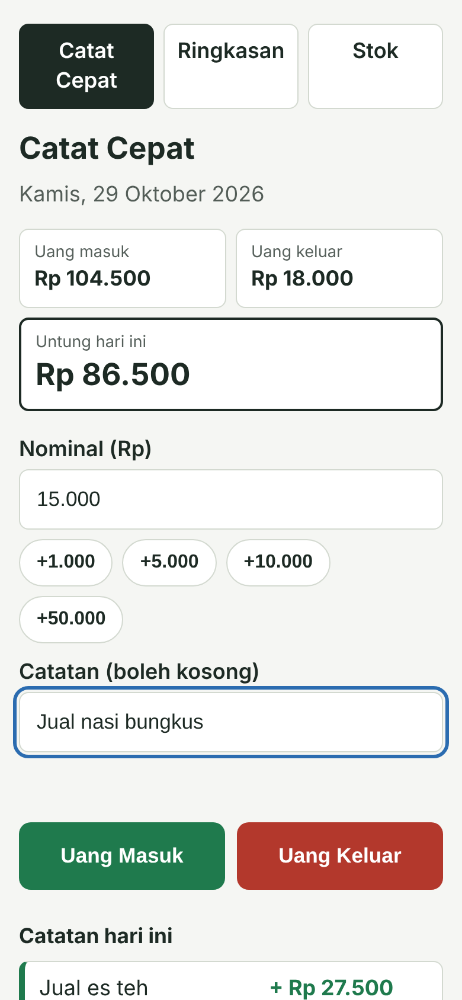
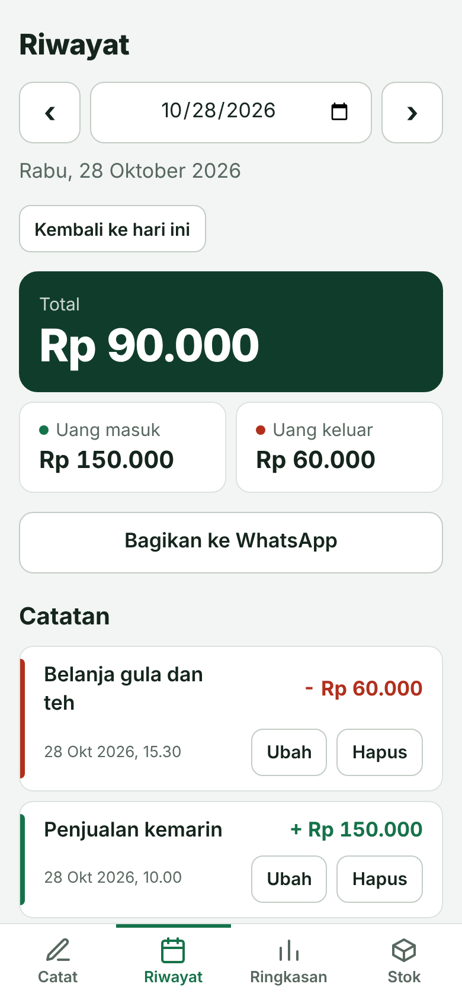
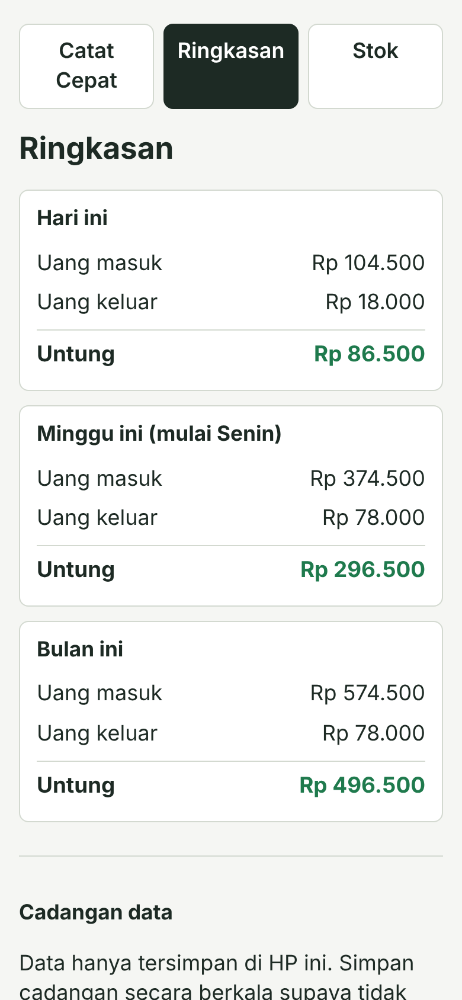
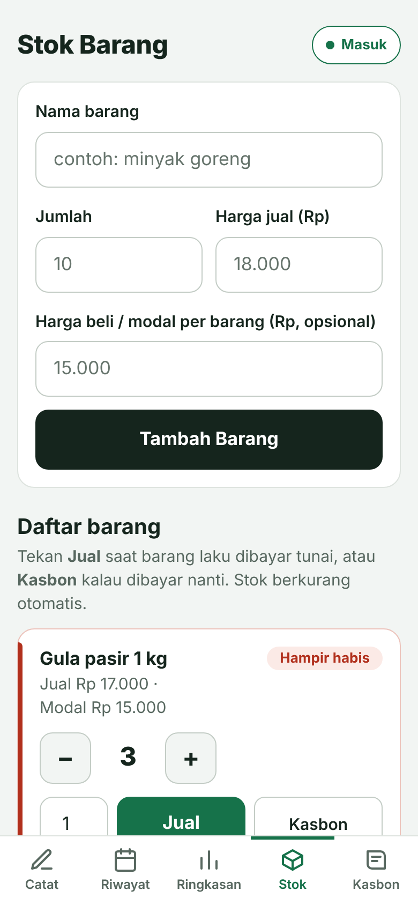
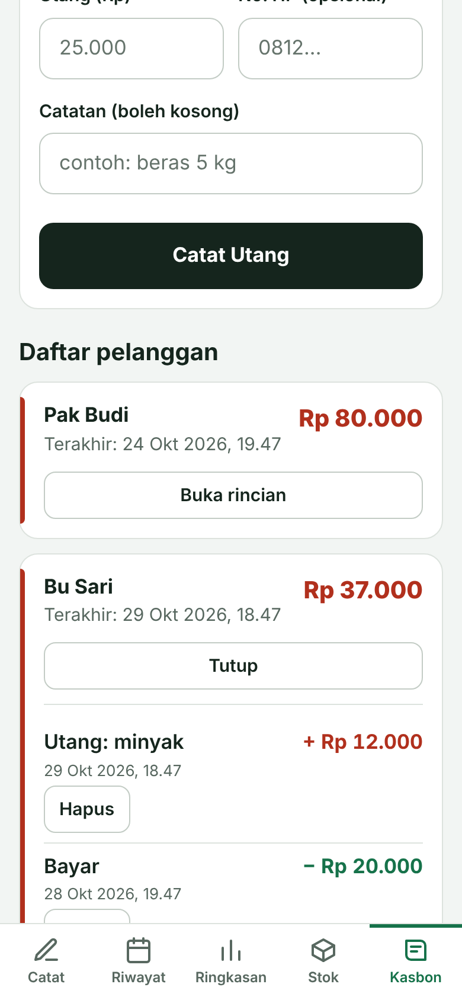

# Buku Warung

Aplikasi web pembukuan sederhana untuk warung dan pedagang kaki lima: catat uang masuk dan keluar, lihat total harian sampai bulanan, dan pantau stok barang. Dibuat dengan HTML, CSS, dan JavaScript murni, tanpa framework.

**Demo:** [zeevolker.github.io/buku-warung](https://zeevolker.github.io/buku-warung/)

<p>
  
  
  
  
  
</p>

*Tangkapan layar memakai data contoh.*

## Masalah yang ingin diselesaikan

Banyak pemilik warung dan pedagang kaki lima tidak mencatat keuangan, atau hanya mencatat di buku tulis. Akibatnya mereka sulit tahu untung sebenarnya dan baru sadar barang habis saat pembeli sudah menanyakannya.

[Tambahkan 2-3 kalimat dari hasil wawancaramu: siapa yang kamu tanya, apa kata mereka tentang cara mencatat sekarang.]

## Fitur

- **Catat Cepat:** catat uang masuk dan keluar dengan satu form dan dua tombol besar
  - nominal otomatis diformat (15.000) dan ada tombol nominal cepat (+1.000 sampai +50.000)
  - tiap catatan menampilkan tanggal dan jam, bisa diubah, dan dihapus dengan konfirmasi
- **Riwayat:** lihat, ubah, dan hapus catatan dari tanggal mana pun (tombol ‹ ›, atau pilih tanggal), dan bagikan total hari itu ke WhatsApp
- **Ringkasan:** uang masuk, uang keluar, dan total untuk hari ini, minggu ini, dan bulan ini, ditambah untung dari barang (harga jual dikurangi modal) untuk penjualan lewat tombol Jual
- **Stok Barang:** daftar barang dengan tombol + dan −, penanda merah untuk barang yang hampir habis, dan waktu terakhir diubah
  - tombol **Jual**: stok berkurang dan uang masuk tercatat sekaligus. Menghapus catatan penjualan mengembalikan stoknya
  - harga jual dan harga beli (modal) bisa diisi atau diubah kapan saja
- **Kasbon:** catat utang pelanggan, terima cicilan, lihat sisa tiap orang dan total yang belum dibayar. Pembayaran bisa otomatis tercatat sebagai uang masuk, dan ada tombol pengingat lewat WhatsApp
- **Cadangan data:** simpan semua data ke file JSON dan pulihkan kembali, dengan validasi file sebelum data diganti. Pengingat muncul kalau sudah 7 hari belum dicadangkan
- **Bisa dipasang di layar utama HP dan jalan offline** (PWA)
- Tampilan mobile-first dengan tombol dan tulisan besar
- Bekerja tanpa server dan tanpa akun, data tersimpan di perangkat pengguna

## Teknologi

- HTML, CSS, dan JavaScript (tanpa framework)
- `localStorage` untuk penyimpanan data
- Web App Manifest dan Service Worker untuk instal dan mode offline
- Di-deploy di GitHub Pages

## Cara menjalankan

1. Unduh atau clone repositori ini
2. Buka `index.html` di browser (atau gunakan ekstensi Live Server di VS Code)

Tidak ada instalasi atau proses build.

## Struktur proyek

```
buku-warung/
├── index.html        Catat Cepat
├── ringkasan.html    Ringkasan harian/mingguan/bulanan
├── riwayat.html      Riwayat per tanggal
├── stok.html         Stok Barang
├── kasbon.html       Kasbon (utang pelanggan)
├── manifest.webmanifest
├── sw.js             Service worker (mode offline)
├── icons/            Ikon aplikasi
├── css/style.css
└── js/
    ├── storage.js    Baca/tulis data (localStorage) dan format tanggal
    ├── ui.js         Komponen bersama (tombol hapus berkonfirmasi, format nominal)
    ├── catat.js
    ├── riwayat.js
    ├── ringkasan.js
    ├── stok.js
    ├── kasbon.js
    ├── cadangan.js   Simpan dan pulihkan data lewat file JSON
    ├── pengingat.js  Pengingat untuk mencadangkan data
    └── pwa.js        Daftar service worker, muat ulang saat ganti hari
```

## Keputusan desain

- **Tanpa framework di versi 1.** Aplikasinya kecil, dan aku ingin menguatkan dasar JavaScript (DOM, event, pengolahan array) sebelum memakai framework.
- **Semua akses data lewat `storage.js`.** Kalau nanti pindah ke database atau backend, hanya file itu yang perlu diubah.
- **Tanggal memakai waktu lokal, bukan UTC.** `toISOString()` memakai UTC, sehingga dini hari di Indonesia tanggalnya bisa mundur sehari.
- **Bahasa sehari-hari.** "Uang Masuk" dan "Uang Keluar", bukan istilah akuntansi.
- **Menu di bawah layar, bukan di atas.** Mudah dijangkau jempol, tidak bisa terlipat di layar sempit, dan disembunyikan saat keyboard terbuka.
- **Satu sistem desain.** Warna, jarak, ukuran huruf, dan bentuk didefinisikan sekali di `:root` lalu dipakai ulang. Elemen yang dibuat menonjol hanya satu: total hari ini.
- **Label "Total", bukan "Untung".** Angkanya uang masuk dikurangi uang keluar (arus kas). Belanja stok ikut mengurangi total hari itu, jadi ini bukan laba sebenarnya, dan labelnya sengaja tidak menjanjikan itu.
- **Kasbon dihitung dari daftar utang dan bayar, bukan satu angka sisa.** Sisa selalu dihitung ulang, jadi salah catat bisa dibetulkan dengan menghapus satu baris, dan pembayaran yang melebihi sisa ditolak.
- **Menu bawah baru muncul lagi sesaat setelah kolom kehilangan fokus.** Kalau tidak, menu menutupi tombol yang baru ditekan.
- **"Total" dan "Untung dari barang" dipisah.** Total tetap arus kas (masuk dikurangi keluar). Untung hanya muncul kalau modal barangnya diketahui, dan penjualan tanpa harga beli tidak dihitung supaya untung tidak terlihat lebih besar dari kenyataan.
- **Cadangan dibuat sebelum fitur lain.** Data hanya ada di satu perangkat, dan kehilangan catatan adalah risiko terbesar bagi pengguna.
- **Service worker mengutamakan internet, salinan sebagai cadangan.** Pembaruan kode langsung sampai ke pengguna, tapi aplikasi tetap terbuka saat sinyal buruk.
- **Gagal menyimpan tidak boleh diam-diam.** Kalau penyimpanan penuh atau browser dalam mode penyamaran, muncul peringatan dan isian form dipertahankan.
- **Urutan daftar stok dibekukan saat menekan + atau −.** Barang yang sedang diubah tidak berpindah tempat di bawah jari pengguna.

## Hasil uji ke pengguna

[Isi setelah kamu menguji ke pedagang. Contoh format:]

- Diuji ke [jumlah] pedagang selama [berapa hari]
- Temuan: [apa yang membuat mereka bingung atau berhenti memakai]
- Perubahan yang dibuat karena temuan itu: [ubah apa dan kenapa]

## Keterbatasan saat ini

- Data tersimpan di browser satu perangkat, jadi tidak tersinkron antar HP. Cadangan manual lewat file JSON mengurangi risiko, tapi harus dilakukan pengguna sendiri
- Data di tab browser dan di aplikasi yang dipasang di layar utama bisa terpisah di sebagian perangkat
- Untung hanya dihitung dari penjualan lewat tombol Jual yang harga belinya diisi. Penjualan yang dicatat manual di Catat Cepat tidak mengurangi stok dan tidak masuk hitungan untung
- Belum ada ekspor laporan ke CSV atau PDF

## Rencana pengembangan

- [x] Cadangan dan pemulihan data (file JSON)
- [x] Bisa dipasang di HP dan jalan offline
- [x] Riwayat per tanggal, termasuk mengubah catatan lama
- [x] Bagikan total harian ke WhatsApp
- [x] Pengingat cadangan
- [x] Hubungkan penjualan dengan pengurangan stok, dan hitung untung dari harga beli
- [ ] Ekspor laporan ke CSV
- [x] Pencatatan kasbon (utang pelanggan)
- [ ] Sinkronisasi data otomatis (backend dan database)
- [ ] Versi dengan framework, setelah kebutuhan dari pengguna jelas
