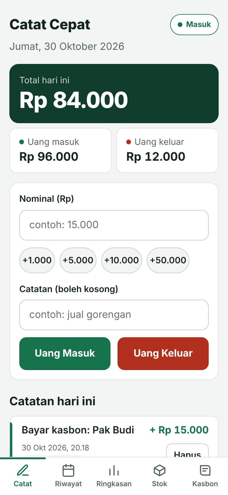

# Buku Warung

Aplikasi pembukuan sederhana untuk warung dan pedagang kaki lima: catat uang masuk dan keluar, jual barang langsung dari daftar stok, kelola kasbon pelanggan, dan lihat ringkasan harian sampai bulanan. Tetap bisa dipakai tanpa sinyal, dan data tersimpan aman di cloud setelah masuk dengan akun.

**Demo:** [zeevolker.github.io/buku-warung](https://zeevolker.github.io/buku-warung/)

<p>
  
  
  
  
</p>

*Tangkapan layar memakai data contoh.*

## Masalah yang ingin diselesaikan

Banyak pemilik warung dan pedagang kaki lima tidak mencatat keuangan, atau hanya mencatat di buku tulis. Akibatnya mereka sulit tahu untung sebenarnya, lupa siapa yang masih berutang, dan baru sadar barang habis saat pembeli sudah menanyakannya.

[Tambahkan 2-3 kalimat dari hasil wawancaramu: siapa yang kamu tanya, apa kata mereka tentang cara mencatat sekarang.]

## Fitur

- **Catat Cepat:** uang masuk dan keluar dengan satu form, nominal otomatis diformat, tombol nominal cepat
- **Stok Barang:** stok berkurang otomatis saat menekan **Jual** (tunai) atau **Kasbon** (dibayar nanti); harga jual dan modal bisa diubah; penanda barang hampir habis
- **Kasbon:** dua jenis, yaitu **barang** (dari daftar stok atau di luar stok) dan **uang tunai** (pinjam dari laci); cicilan, sisa per pelanggan, pengingat lewat WhatsApp
- **Semua saling terhubung:**
  - jual tunai → uang masuk + stok berkurang
  - kasbon barang → utang pelanggan + stok berkurang (tidak masuk Total karena uangnya belum diterima)
  - pinjam uang tunai → utang pelanggan + uang keluar (Total berkurang karena uangnya memang keluar dari laci)
  - terima bayar kasbon → sisa utang berkurang + uang masuk
  - menghapus salah satu sisi ikut membatalkan pasangannya (stok kembali, sisa utang kembali)
- **Riwayat:** lihat, ubah, dan hapus catatan dari tanggal mana pun; bagikan ringkasan hari itu ke WhatsApp
- **Ringkasan:** total kas, untung dari barang (harga jual − modal, termasuk kasbon barang), kasbon diberikan dan dibayar, serta total kasbon yang belum dibayar
- **Akun dan sinkron cloud:** masuk dengan Google atau kode lewat email; data tersinkron ke server dan bisa dipakai di beberapa HP
- **Offline-first:** semua aksi tersimpan di HP dulu, lalu terkirim saat ada sinyal
- **Mode tamu dan cadangan file:** bisa dipakai tanpa akun; data bisa disimpan ke file JSON dan dipulihkan
- **Bisa dipasang di layar utama HP** (PWA)

## Teknologi

- HTML, CSS, JavaScript (ES modules, tanpa framework)
- [Vite](https://vite.dev) untuk server pengembangan dan build
- IndexedDB untuk penyimpanan di HP
- [Supabase](https://supabase.com): PostgreSQL, Row Level Security, dan Auth (Google + email OTP)
- Service worker untuk mode offline
- `node:test` untuk tes unit, GitHub Actions untuk tes dan deploy otomatis ke GitHub Pages

## Arsitektur

```
 Halaman (src/pages)          ── hanya menampilkan dan memanggil aksi
        │
 src/data/repo.js             ── aturan bisnis dan relasi antar data
        │
 src/data/db.js  (IndexedDB)  ── semua data disimpan di HP dulu, ditandai "dirty"
        │
 src/data/sync.js             ── kirim yang dirty, tarik perubahan dari server
        │
 Supabase (PostgreSQL + RLS)  ── satu salinan per akun, dipakai bersama oleh semua HP akun itu
```

### Model data

```
barang     ─< stok_mutasi        stok = jumlah semua mutasi barang itu
pelanggan  ─< kasbon             sisa = utang − bayar
transaksi  ── stok_mutasi        (jual tunai)
kasbon     ── stok_mutasi        (kasbon barang)
kasbon     ── transaksi          (bayar kasbon, pinjam uang tunai)
```

Skema lengkap ada di [`supabase/migrations`](supabase/migrations).

## Keputusan desain

- **Offline-first, bukan online-only.** Sinyal di warung sering lemah. Setiap aksi langsung tersimpan di IndexedDB, dan sinkron berjalan di belakang tanpa membuat pengguna menunggu.
- **Stok dan sisa kasbon dihitung, tidak disimpan sebagai angka.** Kalau dua HP sama-sama menjual barang saat offline, menimpa satu angka "stok" akan menghilangkan salah satu penjualan. Dengan mencatat setiap pergerakan stok sebagai baris baru, hasil gabungannya selalu benar.
- **ID dibuat di HP (UUID).** Data bisa dibuat saat offline tanpa menunggu nomor dari server, dan tidak bentrok dengan data dari HP lain.
- **Versi terbaru yang menang (last-write-wins).** Untuk perubahan seperti nama atau harga barang, versi dengan `updated_at` terbaru dipakai. Aturan yang sama diterapkan di HP dan di trigger database, sehingga HP yang lama offline tidak bisa menimpa perubahan yang lebih baru.
- **Hapus lunak.** Baris tidak dibuang, hanya ditandai `deleted`, supaya penghapusan ikut tersinkron ke HP lain.
- **Keamanan di database, bukan di kode frontend.** Row Level Security memastikan tiap akun hanya bisa membaca dan mengubah datanya sendiri. Foreign key gabungan `(user_id, id)` mencegah data menunjuk ke milik akun lain. Kunci publishable Supabase memang aman ditaruh di frontend.
- **Relasi dijaga di satu tempat (`repo.js`).** Halaman tidak menulis ke database langsung, jadi aturan seperti "hapus penjualan = stok kembali" tidak bisa terlewat.
- **Data versi lama dipindahkan otomatis.** Saat pertama kali dibuka, data dari localStorage (versi 1) diubah ke format baru tanpa mengubah satu angka pun, dan data lamanya tidak dihapus.
- **Kasbon barang tidak mengurangi Total, pinjaman tunai mengurangi.** Total adalah uang di laci. Kasbon barang hanya berarti uangnya belum masuk (yang berkurang stoknya), sedangkan pinjaman tunai benar-benar mengeluarkan uang.
- **Label "Total", bukan "Untung".** Total adalah arus kas. Untung ditampilkan terpisah dan hanya dihitung dari barang yang modalnya diketahui.
- **Keluar akun menghapus data dari HP.** Aman untuk HP yang dipakai bergantian; datanya tetap ada di cloud.

## Menjalankan di komputer

Butuh [Node.js](https://nodejs.org) versi 20.11 atau lebih baru.

```bash
npm install
npm run dev      # buka alamat yang muncul, misalnya http://localhost:5173/buku-warung/
npm test         # tes unit
npm run build    # hasil build di folder dist/
```

Tanpa file `.env.local`, aplikasi berjalan dalam mode tamu (data hanya di browser). Untuk mencoba login saat pengembangan, salin `.env.example` menjadi `.env.local` lalu isi alamat dan kunci Supabase.

## Menyiapkan Supabase

1. Jalankan SQL di `supabase/migrations/` (sudah diterapkan di proyek `buku-warung`).
2. **Authentication → URL Configuration**
   - Site URL: `https://zeevolker.github.io/buku-warung/`
   - Redirect URLs: `https://zeevolker.github.io/buku-warung/**` dan `http://localhost:5173/**`
3. **Authentication → Email Templates**, template *Magic Link* dan *Confirm signup*: tambahkan `{{ .Token }}` ke isi email supaya pengguna menerima kode 6 angka (penting untuk aplikasi yang dipasang di layar utama, karena tautan email terbuka di browser biasa).
4. **Authentication → Providers → Google**: aktifkan, lalu isi Client ID dan Client Secret dari Google Cloud Console (OAuth client tipe *Web application*, dengan Authorized redirect URI `https://<project>.supabase.co/auth/v1/callback`).

## Hasil uji ke pengguna

[Isi setelah kamu menguji ke pedagang. Contoh format:]

- Diuji ke [jumlah] pedagang selama [berapa hari]
- Temuan: [apa yang membuat mereka bingung atau berhenti memakai]
- Perubahan yang dibuat karena temuan itu: [ubah apa dan kenapa]

## Keterbatasan saat ini

- Penjualan yang dicatat manual di Catat Cepat tidak mengurangi stok; pakai tombol Jual di halaman Stok
- Konflik diselesaikan per baris (versi terbaru menang), bukan per kolom
- Email bawaan Supabase dibatasi beberapa email per jam; untuk banyak pengguna perlu SMTP sendiri
- Belum ada ekspor laporan ke CSV atau PDF

## Rencana pengembangan

- [x] Cadangan dan pemulihan data (file JSON)
- [x] PWA: bisa dipasang dan jalan offline
- [x] Riwayat per tanggal dan bagikan ke WhatsApp
- [x] Stok terhubung ke penjualan, untung dari harga beli
- [x] Kasbon terhubung ke stok dan uang masuk
- [x] IndexedDB + sinkron cloud (Supabase) + login Google dan email
- [ ] Belanja stok tercatat sebagai uang keluar
- [ ] Ekspor laporan ke CSV
- [ ] Beberapa pengguna untuk satu warung (pemilik dan penjaga)
