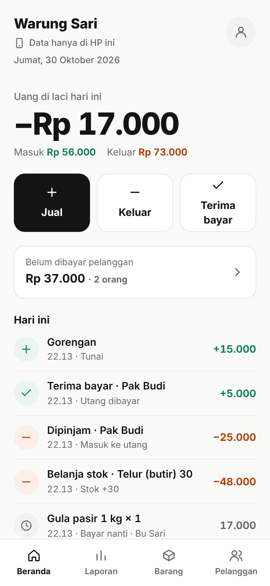
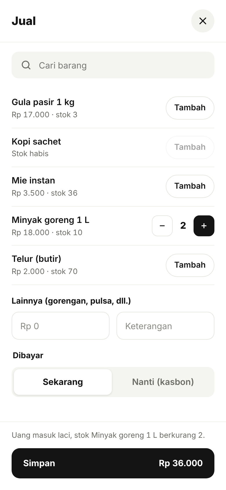
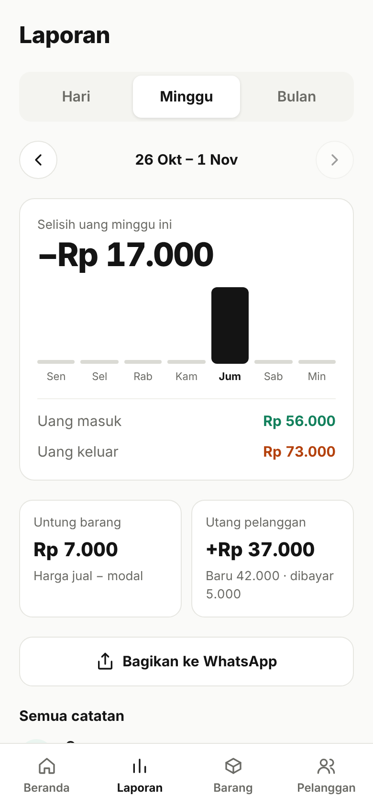
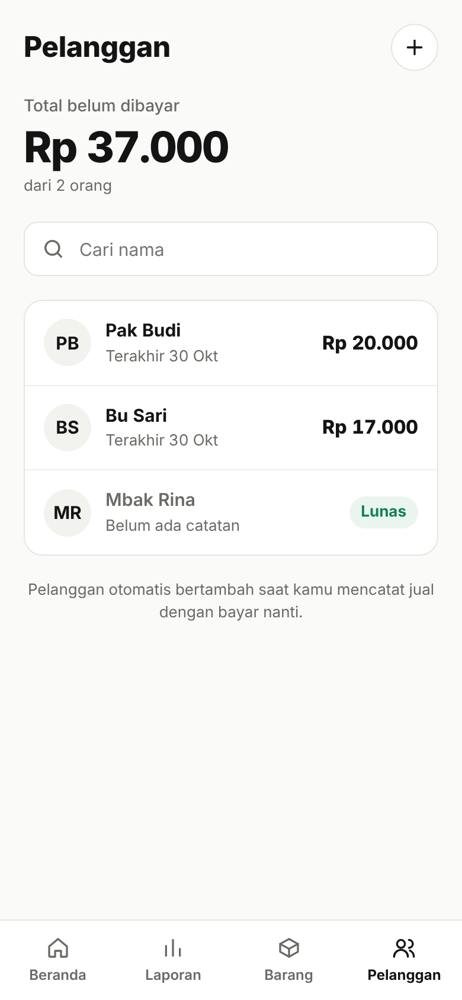

# Buku Warung

Aplikasi pembukuan sederhana untuk warung dan pedagang kaki lima. Semua dimulai dari tiga tombol: **Jual**, **Keluar**, dan **Terima bayar**. Uang di laci, stok barang, utang pelanggan, dan untung terhitung otomatis. Tetap bisa dipakai tanpa sinyal, dan tersimpan aman di cloud setelah masuk dengan akun.

**Demo:** [zeevolker.github.io/buku-warung](https://zeevolker.github.io/buku-warung/)

<p>
  
  
  
  
</p>

*Tangkapan layar memakai data contoh.*

## Masalah yang ingin diselesaikan

Banyak pemilik warung dan pedagang kaki lima tidak mencatat keuangan, atau hanya mencatat di buku tulis. Akibatnya mereka sulit tahu untung sebenarnya, lupa siapa yang masih berutang, dan baru sadar barang habis saat pembeli sudah menanyakannya.

[Tambahkan 2-3 kalimat dari hasil wawancaramu: siapa yang kamu tanya, apa kata mereka tentang cara mencatat sekarang.]

## Cara pakai

Pedagang hanya perlu menjawab dua pertanyaan: **uangnya masuk atau keluar?** dan **dibayar sekarang atau nanti?**

| Kejadian di warung | Yang ditekan |
|---|---|
| Barang laku, dibayar langsung | **Jual** → pilih barang → Dibayar *Sekarang* |
| Barang laku, dibayar nanti (kasbon) | **Jual** → pilih barang → Dibayar *Nanti* → nama pelanggan |
| Jualan yang tidak dicatat stoknya (gorengan, pulsa) | **Jual** → isi nominal di *Lainnya* |
| Belanja barang ke agen | **Keluar** → *Belanja stok* → stok ikut bertambah |
| Bayar listrik, plastik, gas | **Keluar** → *Biaya warung* |
| Pelanggan pinjam uang | **Keluar** → *Dipinjam pelanggan* |
| Pelanggan membayar utang | **Terima bayar** |
| Salah catat | Tekan catatannya → *Hapus*, lalu catat ulang |

## Fitur

- **Beranda:** uang di laci hari ini, tiga tombol utama, total utang pelanggan, dan semua catatan hari ini
- **Laporan:** per hari, minggu, atau bulan, dengan grafik harian, untung barang, perubahan utang pelanggan, dan bagikan ke WhatsApp
- **Barang:** stok berubah otomatis, penanda hampir habis, ubah harga, dan koreksi stok
- **Pelanggan:** siapa yang masih berutang, riwayat tiap pelanggan, dan pengingat lewat WhatsApp
- **Akun:** masuk dengan Google atau email, status penyimpanan yang jelas, nama warung, dan cadangan ke file
- **Offline-first:** semua tersimpan di HP dulu, lalu terkirim sendiri saat ada sinyal
- **Bisa dipasang di layar utama HP** (PWA)

## Teknologi

- HTML, CSS, JavaScript (ES modules, tanpa framework)
- [Vite](https://vite.dev) untuk pengembangan dan build
- IndexedDB untuk penyimpanan di HP
- [Supabase](https://supabase.com): PostgreSQL, Row Level Security, dan Auth (Google + email)
- `node:test` untuk tes unit, GitHub Actions untuk tes dan deploy otomatis ke GitHub Pages

## Cara kerja data

Hanya ada tiga tabel:

```
barang     nama, harga jual, harga beli
pelanggan  nama, nomor HP
catatan    SETIAP kejadian: jual, keluar, bayar, atau koreksi stok
```

Satu kejadian di warung selalu menjadi **satu catatan**. Tidak ada angka stok, utang, atau saldo yang disimpan. Semuanya dihitung dari daftar catatan (`src/data/hitung.js`):

| Catatan | Uang di laci | Stok | Utang pelanggan |
|---|---|---|---|
| Jual, dibayar sekarang | + | − barang yang dijual | |
| Jual, dibayar nanti | | − barang yang dijual | + |
| Keluar, belanja stok | − | + barang yang dibeli | |
| Keluar, biaya warung | − | | |
| Keluar, dipinjam pelanggan | − | | + |
| Terima bayar | + | | − |
| Koreksi stok | | ± | |

Karena itu **menghapus satu catatan otomatis membatalkan semua efeknya**, tanpa aturan tambahan. Penghapusan hanya ditolak kalau hasilnya tidak masuk akal, misalnya utang yang sudah dibayar dihapus sehingga sisanya jadi minus.

## Struktur kode

```
index.html, laporan.html, barang.html, pelanggan.html, akun.html
src/
├── app.js            Dijalankan di setiap halaman: migrasi, akun, sinkron
├── data/
│   ├── hitung.js     Semua perhitungan (fungsi murni, dites di tests/)
│   ├── aksi.js       Semua yang bisa dilakukan pengguna (jual, keluar, bayar, ...)
│   ├── db.js         Penyimpanan IndexedDB
│   ├── sync.js       Sinkron dua arah dengan Supabase
│   ├── supabase.js   Koneksi ke Supabase
│   ├── migrasi.js    Memindahkan data dari versi 1 dan 2
│   └── cadangan.js   Simpan dan pulihkan file cadangan
├── pages/            Satu file per halaman
├── ui/               Potongan tampilan bersama
└── css/style.css
supabase/migrations/  Skema database
tests/                Tes unit
```

## Keputusan desain

- **Satu kejadian = satu catatan.** Versi sebelumnya menyimpan penjualan kasbon di tiga tabel yang harus saling dijaga. Sekarang tidak ada relasi yang perlu "dibetulkan" saat menghapus, dan kodenya jauh lebih mudah dipahami.
- **Stok, utang, dan saldo selalu dihitung, tidak disimpan.** Kalau dua HP mencatat penjualan bersamaan saat offline, hasil gabungannya tetap benar, karena tidak ada satu angka yang saling menimpa.
- **Offline-first.** Sinyal di warung sering lemah, jadi setiap aksi langsung tersimpan di HP dan sinkron berjalan di belakang.
- **Versi terbaru menang.** Untuk perubahan nama atau harga, versi dengan `updated_at` terbaru yang dipakai. Aturan yang sama ada di HP dan di trigger database.
- **Keamanan di database.** Row Level Security memastikan tiap akun hanya bisa membaca datanya sendiri. Kunci publishable Supabase memang aman berada di frontend.
- **Bahasa pedagang, bukan istilah akuntansi.** "Uang di laci", "bayar nanti", "belanja stok". Kata "kasbon" hanya muncul sebagai penjelas.
- **Data lama dipindahkan otomatis** dari versi 1 (localStorage) dan versi 2 (IndexedDB) tanpa mengubah satu angka pun. Ini dibuktikan oleh tes di `tests/migrasi.test.js`.

## Menjalankan di komputer

Butuh [Node.js](https://nodejs.org) versi 20.11 atau lebih baru.

```bash
npm install
npm run dev      # buka alamat yang muncul, misalnya http://localhost:5173/buku-warung/
npm test         # tes unit
npm run build    # hasil build di folder dist/
```

Tanpa file `.env.local`, aplikasi berjalan dalam mode tamu (data hanya di browser). Untuk mencoba login saat pengembangan, salin `.env.example` menjadi `.env.local`.

## Hasil uji ke pengguna

[Isi setelah kamu menguji ke pedagang. Contoh format:]

- Diuji ke [jumlah] pedagang selama [berapa hari]
- Temuan: [apa yang membuat mereka bingung atau berhenti memakai]
- Perubahan yang dibuat karena temuan itu: [ubah apa dan kenapa]

## Keterbatasan

- Catatan tidak bisa diubah, hanya dihapus lalu dicatat ulang (sengaja, supaya sederhana)
- Email bawaan Supabase dibatasi beberapa email per jam; untuk banyak pengguna perlu SMTP sendiri
- Belum ada ekspor laporan ke CSV atau PDF

## Rencana pengembangan

- [x] Cadangan, PWA, riwayat, dan bagikan ke WhatsApp
- [x] Stok, untung dari harga beli, dan utang pelanggan
- [x] Sinkron cloud dengan login Google dan email
- [x] Versi 3: alur tiga tombol dan model data satu catatan
- [ ] Ekspor laporan ke CSV
- [ ] Beberapa pengguna untuk satu warung (pemilik dan penjaga)
